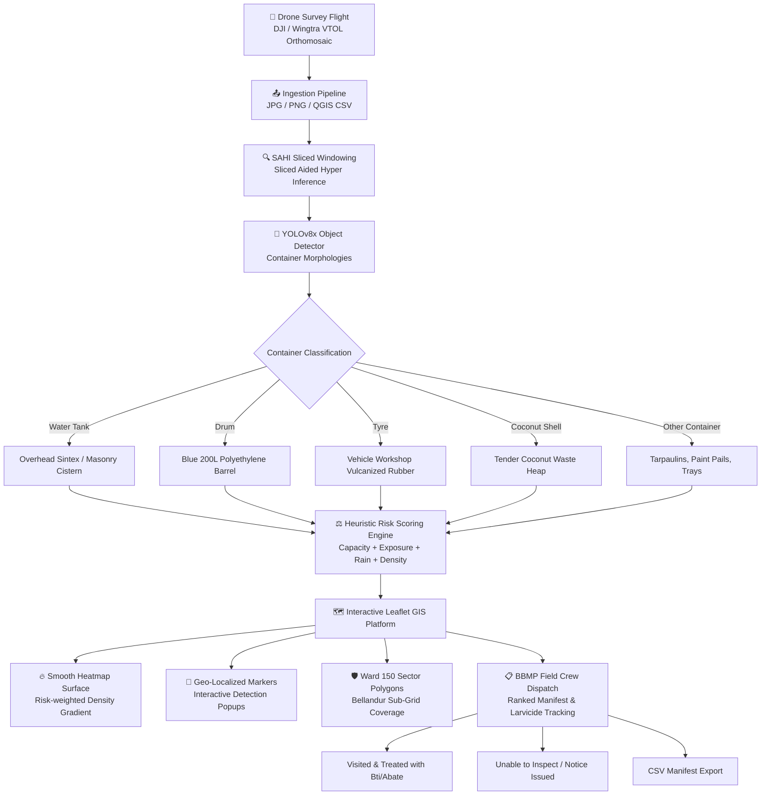

<div align="center">

# 🦟 The Last Bite — Dengue Habitat Intelligence
### Autonomous Aerial Drone Computer Vision & Geospatial Risk-Mapping Platform for Indian Municipal Vector Control (Bengaluru Pilot)

[](https://react.dev/)
[](https://www.typescriptlang.org/)
[](https://vitejs.dev/)
[](https://tailwindcss.com/)
[](https://leafletjs.com/)
[](https://github.com/ultralytics/ultralytics)
[](https://sdgs.un.org/goals)
[](LICENSE)

<br/>

> **“Identify potential breeding habitats. Prioritize inspections. Help prevent dengue.”**
>
> *Deployed for Bruhat Bengaluru Mahanagara Palike (BBMP) Ward 150 — Bellandur & surrounding high-density monsoon vulnerability corridors.*

<br/>

[🌟 Key Capabilities](#-key-capabilities) •
[🗺️ Interactive GIS Map](#️-interactive-gis-map) •
[📊 Risk Scoring Heuristic](#-transparent-risk-scoring-rubric) •
[🏗️ Architecture](#-system-architecture--pipeline) •
[📦 Indian Container Taxonomy](#-indian-container-taxonomy) •
[🚀 Quickstart](#-quickstart--local-setup) •
[🌐 UN SDGs](#-un-sustainable-development-goals-sdgs)

---

</div>

## 📌 Executive Summary & Problem Context

Dengue is one of the most rapidly propagating vector-borne viral diseases in tropical urban ecosystems, affecting over **33 million individuals annually in India**. Transmitted primarily by *Aedes aegypti* and *Aedes albopictus* mosquitoes, transmission cycles explode immediately following monsoon precipitation when stagnant rainwater collects across dense human habitations.

### The Critical Bottleneck in Traditional Vector Control
- **Slow & Reactive Ground Sweeps**: Municipal health inspectors (such as BBMP field teams) rely on door-to-door physical checks, covering only 2–5% of urban territory per week.
- **Hidden Micro-Habitats**: Rooftop overhead Sintex tanks, building gutters, and abandoned perimeter tyre yards are invisible from street-level sightlines.
- **Delayed Interventions**: By the time positive dengue cases are reported at local Primary Health Centres (PHCs), adult mosquito populations have already multiplied exponentially.

### The Solution: Autonomous Aerial Intelligence
**The Last Bite** transforms high-resolution drone orthomosaic imagery (sub-decimeter Ground Sample Distance) into actionable, georeferenced municipal vector-control manifests. Using object detection and multi-factor heuristic risk scoring, field crews are dispatched directly to high-probability breeding niches before outbreaks ignite.

> ⚠️ **Scientific Surrogate Transparency**: Optical drone sensors detect **potential breeding-site containers** (surrogate artificial micro-habitats), **NOT mosquito larvae directly or confirmed dengue infections**. The platform prioritizes inspection workflows while maintaining strict scientific separation between predicted risk and inspector-confirmed field findings.

---

## 🌟 Key Capabilities

| Pillar | Features & Technical Delivery |
| :--- | :--- |
| 🛰️ **Geospatial Intelligence** | Interactive Leaflet GIS map with **smooth `leaflet.heat` density surfaces**, individual risk pins, ward sub-sector boundaries, and Dark Carto / Satellite / OSM layer switching. |
| 🇮🇳 **Indian Urban Context** | Centered on **Bellandur, Bengaluru**, targeting real localized container classes: unsealed Sintex rooftop tanks, blue 200L HDPE barrels, discarded tyres, and tender coconut shell (*elaneer bonda*) vendor heaps. |
| 🧮 **Transparent Risk Scoring** | Multi-factor 0–100 heuristic scoring rubric combining container morphology, open-air sun exposure, water presence, recent monsoon rain, shade, and residential proximity. |
| 📋 **Field Inspection Dispatch** | Dedicated inspector logbook to track ground findings (**Visited**, **Confirmed Habitat with Larvae**, **Temephos / Bti applied**, and **Unable to Inspect** for locked gates). |
| 📄 **Data Ingestion & Export** | Drag-and-drop drone imagery ingestion, QGIS-compatible CSV manifest import, and one-click download of prioritized inspection manifests. |
| 🌍 **SDG Alignment** | Grounded in UN Sustainable Development Goals: **SDG 3** (Health), **SDG 6** (Clean Water), and **SDG 11** (Resilient Sustainable Cities). |

---

## 🏗️ System Architecture & Pipeline



---

## 📦 Indian Container Taxonomy

The system classifies containers based on Indian urban vector biology:

| Container Type | Risk Weight | Typical Volume | Epidemiological Vector Niche in Bengaluru | Recommended Field Intervention |
| :--- | :---: | :---: | :--- | :--- |
| **Water tank** | **88 / 100** | 500 – 2000 L | Rooftop Sintex poly or masonry tanks with broken/missing lids. Perennial domestic breeding source. | Mandatory nylon mesh cover retrofit; shock chlorination. |
| **Drum** | **82 / 100** | 100 – 200 L | Blue 200L HDPE drums kept in utility yards and construction sheds due to intermittent water supply. | Invert empty drums; distribute Temephos (Abate 1SG) granules. |
| **Tyre** | **92 / 100** | 5 – 15 L | Auto-rickshaw and truck tyres piled outside puncture garages on Outer Ring Road (ORR). Retains rainwater and thermal heat. | Physical clearance, puncturing drainage holes, or larvicide dunks. |
| **Coconut shell** | **78 / 100** | 0.2 – 0.6 L | Discarded tender coconut (*elaneer bonda*) husks piled at roadside juice stalls. Natural warm micro-incubators. | Immediate municipal solid waste sweep by BBMP auto tippers. |
| **Other container** | **52 / 100** | 2 – 30 L | Sagging construction tarpaulins, paint buckets, discarded packaging, and flowerpot saucers. | Solid waste clearance, tensioning sagged sheets, flushing gutters. |

---

## 🧮 Transparent Risk Scoring Rubric

Rather than a black-box model, each container receives a **transparent 0–100 composite risk score**:

$$\text{Risk Score} = 0.35 \times W_c + 0.25 \times E_{open} + 0.20 \times W_{water} + 0.10 \times N_{neglect} + 0.10 \times P_{residential}$$

### Contributing Factor Weights:
1. **Container Morphology Weight ($W_c$, 35%)**: Evaluates water-holding capacity and geometry (Tyres: 92, Tanks: 88, Drums: 82, Coconut shells: 78, Others: 52).
2. **Exposed / Open Access ($E_{open}$, 25%)**: Open-air access allowing direct rainwater accumulation and mosquito oviposition.
3. **Observed Water Presence ($W_{water}$, 20%)**: High weight when standing water is detected or reported. Treated as neutral when unknown.
4. **Neglect / Accumulation ($N_{neglect}$, 10%)**: Presence of algae, organic detritus, or prolonged unmanaged storage.
5. **Residential Proximity ($P_{residential}$, 10%)**: Spatial distance to human habitations (*Aedes aegypti* has a flight range under 100 meters).

### Priority Categories:
- 🔴 **High Priority (70 – 100)**: Immediate field inspection within 24–48 hours.
- 🟡 **Medium Priority (40 – 69)**: Scheduled ground surveillance within 5 days.
- 🟢 **Low Priority (0 – 39)**: Monitored during routine ward sanitation sweeps.

---

## 🗺️ Interactive GIS Map

The central dashboard provides an interactive Leaflet mapping engine:
- **Default Bengaluru Center**: Bellandur, Bengaluru (`12.9345° N, 77.6740° E`), with quick reset button.
- **Three Dynamic View Modes**:
  1. **Heatmap View**: Uses `leaflet.heat` to synthesize a continuous density gradient (Green $\rightarrow$ Yellow $\rightarrow$ Crimson Red) proportional to calculated risk.
  2. **Site Markers View**: High-definition custom pins color-coded by risk with pulsing rings for high-priority sites. Clicking any marker reveals telemetry and launches the detailed inspector modal.
  3. **Ward Sectors View**: Boundary polygon overlays covering Bellandur Ward 150 sub-sectors (Grid A: Green Glen Layout, Grid B: Bellandur Gate, Grid C: Lake Fringe, Grid D: Devarabisanahalli).
- **GPS Safety Integrity**: Images uploaded without EXIF GPS (e.g. `BLR-BEL-012`) are tagged **“Location unavailable”** and kept off the map with an alert banner, while remaining fully accessible in the ranked queue.

---

## 📋 Field Inspection Protocol & Management

In vector epidemiology, municipal field findings must never be conflated with raw AI predictions:

```
[AI Model Prediction] ---> [Inspection Status Logged] ---> [Confirmed Field Finding]
  - Predicted Container       - Pending / Scheduled           - Larvae Observed: YES / NO
  - Confidence: 92%           - Visited / Confirmed           - Larvicide Applied: Abate / Bti
  - Heuristic Risk: 88/100    - Unable to Inspect (Locked)    - Container Inverted / Destroyed
```

> 🛡️ **Crucial Health Protocol Compliance**: The status **“Unable to inspect”** is recorded for locked residential gates, inaccessible roofs, or denied entry. In **The Last Bite**, this status is **explicitly preserved as a high-concern site and NEVER treated as a negative finding**.

---

## 📄 CSV Manifest Data Schema

The platform supports bi-directional CSV synchronization with QGIS and municipal databases:

```csv
Priority Rank,Site ID,Image ID,Container Type,Container Label,Confidence (%),Risk Score (0-100),Risk Category,Ward Name,Neighborhood,Location Name,Latitude,Longitude,GPS Status,Inspection Status,Exposed to Rain,Water Present,Recent Rain,Shaded,Neglected,Inspector Name,Larvae Observed,Larvicide Applied,Larvicide Type,Detected At,Field Notes
1,"BLR-BEL-001","img-blr-01","tyre","Discarded Tyres Stack (12 Units)",94.0,94,"HIGH","Ward 150 - Bellandur","Bellandur Gate","Puncture Works & Garage Perimeter, ORR Service Road",12.9365,77.6712,"Available","CONFIRMED HABITAT",YES,YES,YES,NO,YES,"Senior Health Inspector Ramesh Kumar",YES,YES,"Temephos (Abate 1SG)","2026-10-24T09:15:00Z","12 heavy truck tyres treated with granular Abate"
```

---

## 🌐 UN Sustainable Development Goals (SDGs)

<div align="center">

| | Goal | Target & Direct Contribution |
| :---: | :--- | :--- |
|  | **SDG 3: Good Health and Well-being** | **Target 3.3**: End epidemics of neglected tropical diseases and vector-borne infections. Halts transmission before hospitalizations escalate. |
|  | **SDG 6: Clean Water and Sanitation** | **Target 6.3**: Eliminates stagnant, unsealed domestic water reservoirs and standing wastewater pools across peri-urban settlements. |
|  | **SDG 11: Sustainable Cities and Communities** | **Target 11.5 & 11.b**: Provides climate-resilient early warning spatial infrastructure for municipal corporations. |

</div>

---

## 📁 Repository Directory Structure

```
c:/Users/Admin/Desktop/24hr hackaton/
├── index.html                  # HTML entry point with SEO metadata & Inter fonts
├── package.json                # Project dependencies & npm scripts
├── vite.config.ts              # Vite 8 config with @tailwindcss/vite plugin
├── tsconfig.app.json           # Optimized TypeScript compiler options
├── LICENSE                     # MIT Open Source License
├── README.md                   # Comprehensive project documentation
├── public/                     # Static assets
└── src/
    ├── main.tsx                # React DOM root render
    ├── App.tsx                 # Main application controller & state store
    ├── index.css               # Design system, Leaflet overrides & theme tokens
    ├── types/
    │   └── analysis.ts         # TypeScript interfaces (Site, Risk, GPS, Records)
    ├── data/
    │   └── bengaluruSites.ts   # Bellandur dataset, container metadata & ward zones
    ├── services/
    │   └── analysisService.ts  # Typed service layer simulating async ML workflow
    ├── utils/
    │   ├── exportCsv.ts        # Dynamic CSV manifest generator & downloader
    │   └── formatters.ts       # Coordinates, file sizes, and risk badge helpers
    └── components/
        ├── common/
        │   └── Sidebar.tsx     # Left fixed navigation with live count badges & SDGs
        ├── home/
        │   └── HomeView.tsx    # Indian municipal overview, tagline & taxonomy cards
        ├── upload/
        │   └── UploadView.tsx  # Aerial drone & CSV ingestion with demo loader
        ├── dashboard/
        │   ├── ResultsMapView.tsx     # Central layout assembling map, KPIs & filters
        │   ├── LeafletMap.tsx         # Leaflet map (Heatmap, Markers, Ward coverage)
        │   ├── BengaluruKpiCards.tsx  # 4 KPI cards with "Demo Mode" labeling
        │   ├── FilterPanel.tsx        # Container, risk category & slider filters
        │   ├── RankedSitesList.tsx    # Priority sorted table with map cross-focus
        │   └── SiteDetailModal.tsx    # Bounding box overlay & BBMP field logging
        ├── inspection/
        │   └── InspectionTasksView.tsx # Field task dispatch & ground-truth verification
        ├── reports/
        │   └── ReportsView.tsx        # Risk distribution graphs & CSV manifest export
        └── about/
            └── AboutView.tsx          # Scientific surrogate science & UN SDG cards
```

---

## 🚀 Quickstart & Local Setup

### Prerequisites
- [Node.js](https://nodejs.org/) (v18.0.0 or higher)
- [npm](https://www.npmjs.com/) (v9.0.0 or higher)

### 1. Clone the Repository
```bash
git clone https://github.com/ayushbhanja818-create/aissec1.git
cd aissec1
```

### 2. Install Dependencies
```bash
npm install
```

### 3. Start the Development Server
```bash
npm run dev
```
Open your browser and navigate to **`http://localhost:5173/`**.

### 4. Build for Production
```bash
npm run build
```
Creates an optimized production bundle in the `dist/` directory.

---

## 🛠️ Technology Stack

| Layer | Technologies |
| :--- | :--- |
| **Frontend Framework** | **React 19** (`react`, `react-dom`) |
| **Build Tooling** | **Vite 8** (`@vitejs/plugin-react`) |
| **Language** | **TypeScript 5.x** (Strictly typed interfaces) |
| **Styling** | **Tailwind CSS v4** (`@tailwindcss/vite`), Custom CSS tokens |
| **Geospatial Mapping** | **Leaflet 1.9.4**, **`leaflet.heat`**, CartoDB Dark Matter, Esri Satellite, OpenStreetMap |
| **Icons & UI** | **Lucide React** (`lucide-react`) |
| **AI Inference Architecture** | **YOLOv8x** with **SAHI** (Sliced Aided Hyper Inference) |
| **Backend Contract (Target)** | **Python FastAPI** REST API service layer |

---

## 👥 Hackathon Team & Acknowledgments

- **Team**: AISSEC Innovation Lab
- **Location**: Bengaluru, Karnataka, India
- **Adherence**: Developed for university hackathon presentation and municipal vector-control pilot demonstrations.
- **Data Attributions**: Map tiles by [CARTO](https://carto.com/), [Esri](https://www.esri.com/), and [OpenStreetMap Contributors](https://www.openstreetmap.org/).

<br/>

<div align="center">
  <b>Built with ❤️ to safeguard urban communities against vector-borne diseases.</b>
</div>
